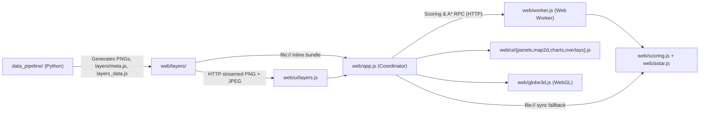

# Contributing to Mars Decision Engine

## Architecture Overview

The repository produces scientifically grounded Mars landing-site rasters from NASA MOLA/TES/THEMIS/MRO datasets in Python and serves an interactive zero-dependency WebGL/Canvas2D mission explorer in the browser.



### Module Responsibilities

- **`data_pipeline/`**: Downloads, reprojects, and builds global 4096×2048 (`0.0879°/px`, ~5.2 km/px) Mars datasets (`build_5km.py`, `caves.py`) into 8-bit rasters plus `web/layers/meta.js` and offline `web/layers_data.js`.
- **`web/scoring.js`**: Pure-JS weighted-geometric site feasibility index, solar dust-storm power model, slope penalty, subsurface ice hydration, and atmospheric landing pressure model (`UMD` module used by both main thread and Worker).
- **`web/astar.js`**: Adaptive-window 8-connected A\* rover path planner across spherical Mars topography with longitude wrap-around and flat/firm stop annotations.
- **`web/worker.js`**: Off-main-thread Web Worker running weighted scoring, Monte Carlo sensitivity perturbations, and A\* route planning over transferred `Uint8Array` raster planes.
- **`web/ui/layers.js`**: Dual delivery raster store (`layers_data.js` script load on `file://`; lazy HTTP `` decode including `base.jpg` + `viking_4k.jpg` albedo loading on `http(s)://`).
- **`web/ui/panels.js`**: Accessible candidate cards (`<meter class="crit-meter">`), criteria sliders, ESC-escaped inspector text, and live screen-reader announcements (`#sr-status`).
- **`web/ui/map2d.js`**: 2D canvas viewport, pointer pan/zoom/pinch, keyboard pan/zoom, graticule, route/region/reticle overlays, and scale bar.
- **`web/globe3d.js`**: Dependency-free WebGL globe with procedural fallback normal/specular/AO shaders and `webglcontextlost`/`webglcontextrestored` handling.
- **`web/app.js`**: Application coordinator wiring DOM controls, deep links, theme toggle, modal focus trap, and Worker/fallback dispatch.

## Dual Delivery (`file://` vs HTTP `dist/`)

- **`web/layers_data.js`** (`25.63 MB`) embeds Base64 rasters solely so opening `web/index.html` offline via `file://` works without CORS errors.
- Over `http://` or `https://`, `web/index.html` streams compact PNG rasters and does **not** load `layers_data.js`.
- **`npm run build`** copies `web/` into `dist/` while omitting `layers_data.js`, yielding a lean static bundle for web hosting (`vercel.json` enforces strict CSP headers with no `'unsafe-inline'`).

## Local Development & Checks

Run all automated suites before opening a pull request:

```bash
node tests/scoring.test.js
node tests/ui.test.js
node tests/integrity.test.js
python tests/test_pipeline.py
node tests/e2e.test.js
node tools/validate.js
node tools/build.js
```

Or run the full script via npm:

```bash
npm test
npm run build
```

## Coding Conventions

1. **Zero runtime dependencies**: Do not add third-party packages to `web/` or `package.json` runtime dependencies.
2. **Strict CSP compliance**: Never emit inline `style="..."`, inline `<script>`, or `on*=` attributes in HTML or JS template strings; `tests/integrity.test.js` and `tests/e2e.test.js` fail on CSP regressions.
3. **XSS safety**: Escape all dynamic text inserted into HTML templates via `escHtml`.
4. **Cross-platform determinism**: Keep `scoring.js` and `astar.js` pure UMD modules that run identically in browsers, Web Workers, and Node.js.
5. **Accessibility**: Maintain keyboard operability, light/dark high-contrast tokens, semantic controls (`<meter>`, ARIA attributes), and `#sr-status` announcements.
