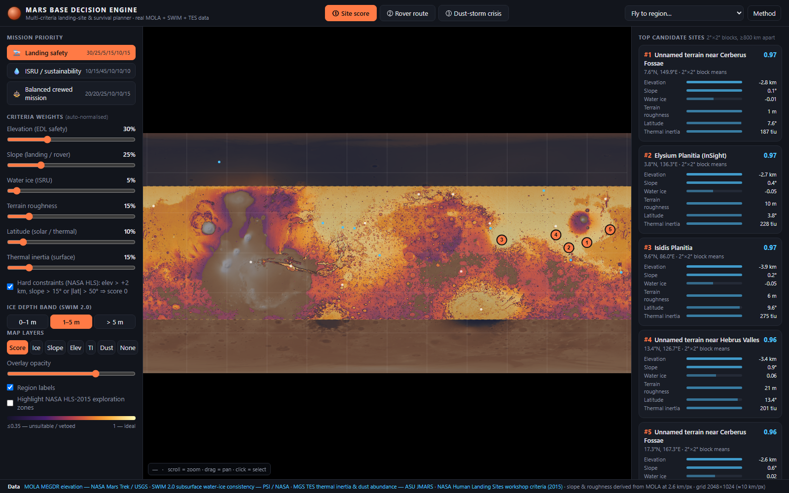

# Martiap — Mars EVA & Base Decision Engine

**NASA Space Apps Challenge — "Interplanetary Survival Guide: Martian Map"**

Martiap helps a mission team answer three questions on real NASA orbital data: **where to land**, **how far crews and rovers
can safely travel from there**, and **whether the base survives a global dust storm**. Live at
<https://martiap.space>.



## One flow, four tabs

| Tab | What it answers | Data / model |
|---|---|---|
| **Landing site** | Which regions best balance safe landing, water ice and daily life, and what does one chosen spot look like? Mission presets and weight sliders (HLS-2015 vetoes: elevation ≤ +2 km, slope, \|lat\| ≤ 50°), Top-5 candidates with 100-run Monte Carlo stability (95 % Wilson interval). Pin any spot for its compatibility score, what hurts it, and each rover class's range. | MOLA elevation / slope / roughness (~5.2 km/px), SWIM 2.0 ice consistency, TES thermal inertia and dust, MSL-RAD-calibrated GCR dose, MGC³ cave candidates (unconfirmed); rover energy/range model per class (assumptions marked in `web/vehicles.json`) |
| **Tactical EVA · 16 km²** | Around a chosen site, which 100 m cells are drivable, which are risky, and what limits the rover? | Pre-cut **4 km × 4 km, 40 × 40 cells at 100 m** from the MOLA-HRSC 200 m blended DEM and THEMIS 100 m day-IR mosaic for 9 sites (4 well-known landing areas + 5 Top-5 candidates); optional live JMARS WMS queries (off by default) |
| **Rover route** | Safest A* path between two points for a Mini, Lab or Crewed rover (or a walking EVA): distance, climb, slope check, sols needed, energy and recharge stops. | 8-connected spherical A* on the 4096 × 2048 grid with slope, roughness and loose-dust costs |
| **Dust-storm power** | Does the base keep power and heat through a 2018-class storm (τ up to ~11)? A strip under the sliders gives the answer immediately, with per-rover survival. | 120-sol power/thermal simulation calibrated to Opportunity's June 2018 storm (τ ≈ 10.8), seasonal insolation, dust on panels, Kilopower 10 kWe design target, SPE shelter depth |

Plus a 2D map / 3D WebGL MOLA globe and an **Export brief** button (JSON + printable report + GeoJSON).

## What is a model, what is data, what is a heuristic

Being explicit about this matters more than any single number:

* **Measured data:** MOLA, MOLA-HRSC, THEMIS, TES, SWIM 2.0, MSL-RAD calibration, Opportunity 2018 storm, NASA rover drive records, Apollo EVA metabolic rates.
* **Physical models with stated assumptions:** storm power/thermal balance, rover energy/range, A* costs, suit metabolic model (Pandolf form, its one free constant calibrated to the Apollo lunar EVA mean).
* **Heuristic, not validated:** the **dust-lifting / dust-devil risk index** (hand-tuned rules on physically motivated features; inputs are modelled from site, season and time of day — there is no live sensor feed). It is shown as a 0–100 index, never as a probability, and no accuracy is claimed.
* **Concept values:** crewed pressurized-rover parameters (no such vehicle has flown).

## Validation

`node tools/validate.js` writes [`docs/validation.md`](docs/validation.md):

1. **Real landers** rank in the **90th percentile** of their own latitude band under *Landing safety* (random: 50th, p < 0.005). Partly circular — lander sites were picked from similar slope/elevation data — so this is a sanity check.
2. **All 39 NASA HLS-2015 Exploration Zones** rank in the **71st percentile** under *Balanced crewed mission* (random: 49th, p < 0.005). This is the more independent test.
3. **Suit metabolic model vs Apollo:** at lunar gravity the model gives ~271 W, inside the Apollo per-EVA range (822–1267 kJ/h ≈ 228–352 W; mean 234 kcal/h ≈ 272 W, NASA TN D-7883). Mars values are extrapolations.
4. **Dust-risk index behaviour checks** only (calm → low, deep pressure drop → high, night < afternoon, perihelion season > aphelion). These are not accuracy tests.

## Run locally

```
web/index.html          # open directly in a modern browser (file:// works offline via web/layers_data.js)
```

Deep links: `index.html?preset=isru`, `?view=3d`, `?demo=route&from=Jezero&to=Nili`, `?demo=crisis&site=Arcadia&tau=9&kp=1`.

**What runs where:** all analysis runs in the browser with no third-party JavaScript libraries. The hosted site has one
small Vercel serverless proxy (`/api/wms`, optional live JMARS queries in Tactical EVA, off by default) and loads its fonts
from Google Fonts (system fonts are used when unavailable). A service worker caches the app for offline use after the
first visit.

## Tests and build

```bash
node tests/scoring.test.js      # scoring, A*, storm, radiation, ice access, heating, SPE, suit model, dust-risk index
node tests/ui.test.js           # UI modules, brief/GeoJSON export, i18n parity, landing site, rover classes, storm verdict
node tests/tactical_eva.test.js # 16 km² Tactical EVA engine, configs, VICAR parsing
node tests/integrity.test.js    # DOM/i18n sync, strict CSP, accessibility, every service-worker asset exists
python tests/test_pipeline.py   # data pipeline unit checks
python tests/test_robotics.py   # robotics kernel and MAVLink export
node tests/e2e.test.js          # headless Chromium (HTTP + file://, Web Worker, WebGL, CSP)
node tools/build.js             # dist/ for HTTP hosting (excludes the file://-only layers_data.js)
node tools/validate.js          # -> docs/validation.md
```

**Optional relief tiles:** `node tools/build_detail_tiles.mjs` can generate sharper zoom tiles from a locally downloaded
MOLA-HRSC 200 m DEM. They are **not** generated or deployed; `web/tiles/manifest.json` is a placeholder and the map
uses the 5.2 km/px base layers.

## Measured dust climatology (bundled)

`web/dust_climatology_data.js` (~200 KB) holds **13 Mars years (MY24–MY36) of the Montabone et al. column dust optical
depth maps** (kriged daily maps, LMD Mars Climate Database, CC BY-SA), reduced to a 6°×5° grid and twelve 30° Ls seasons:
typical haze, dusty-day haze (90th percentile) and the share of sols with regional-storm haze (visible τ ≥ 1.5 at 610 Pa).
Each Mars year contributes one daily value per sol, so no year is counted twice.

It drives: rover range and driving visibility (Landing site), route energy (Rover route), the haze before a storm and the
storm simulation (Dust-storm power), the "Typical (data)" preset in Tactical EVA, the dust-risk index's storm-season term,
and the **dust calendar** on the Landing site tab (pick a mission date → Mars season → measured haze for that site; it
shows past behaviour, not a forecast). The only weather variable in this dataset is dust; wind, temperature and pressure
are not included.

To rebuild: download the kriged maps from <https://www-mars.lmd.jussieu.fr/mars/dust_climatology/>, then
`python data_pipeline/build_dust_climatology.py <folder>` and `node tools/build.js`. Raw `.nc` files are git-ignored.

## Rebuild the data layers (optional)

```powershell
cd data_pipeline
powershell -ExecutionPolicy Bypass -File download.ps1
pip install numpy pillow tifffile imagecodecs
python preprocess.py
python download_mola16.py
python mola16.py
python build_5km.py          # shipped 4096x2048 layer set
python fetch_eva_cutouts.py  # 16 km² Tactical EVA pre-cuts (with node ../tools/precut_16km2.mjs)
```

## Repository layout

```
api/             wms.js   Optional JMARS WMS proxy for live Tactical EVA queries
data_pipeline/   Download and preprocessing scripts for all layers and Tactical EVA pre-cuts
web/             index.html, style.css, app.js, worker.js, sw.js, globe3d.js, scoring.js, astar.js, storm.js,
                 tactical_eva_engine.js, vehicles.json (+ vehicles_data.js mirror), layers/
web/ui/          panels.js, landing_site.js, tactical_eva_ui.js, map2d.js, brief.js, i18n.js (EN/TR), …
tools/           validate.js, build.js, sync_configs_to_js.js, hls2015_ez_sites.json
robotics/        ROS 2 node, MAVLink waypoint exporter, HIL test bridge (simulated telemetry by default)
tests/           scoring, ui, tactical_eva, integrity, e2e, test_pipeline.py, test_robotics.py
docs/            methodology.md, validation.md, pitch.md, yarisma_raporu_tr.md
```

## Primary data sources

* **MOLA** 16-bit MEGDR mosaic (USGS Astrogeology), delivered at 4096 × 2048 (~5.2 km/px) for elevation, 90th-percentile slope and roughness.
* **MOLA-HRSC blended DEM 200 m** and **THEMIS day-IR 100 m** mosaics (USGS) for the 16 km² pre-cuts.
* **SWIM 2.0** subsurface ice consistency (PSI / NASA; Morgan et al. 2021), a consistency index — not ice concentration.
* **TES** thermal inertia and dust (Putzig & Mellon; Bandfield), used as grain-size proxies, not bearing strength.
* **Viking MDIM 2.1** colour mosaic for display.
* **MGC³** cave candidates (Cushing 2017), unconfirmed.
* **NASA HLS-2015** Exploration Zones (39 sites) for validation.
* **MSL-RAD** surface dose at Gale (Hassler et al. 2014, ~0.64 mSv/day), extrapolated with ±18.8 % uncertainty.
* **MER Opportunity** June 2018 storm (τ ≈ 10.8) for storm attenuation.
* **Apollo EVA metabolic rates** (Waligora et al. 1975, NASA TN D-7883) for the suit model.
