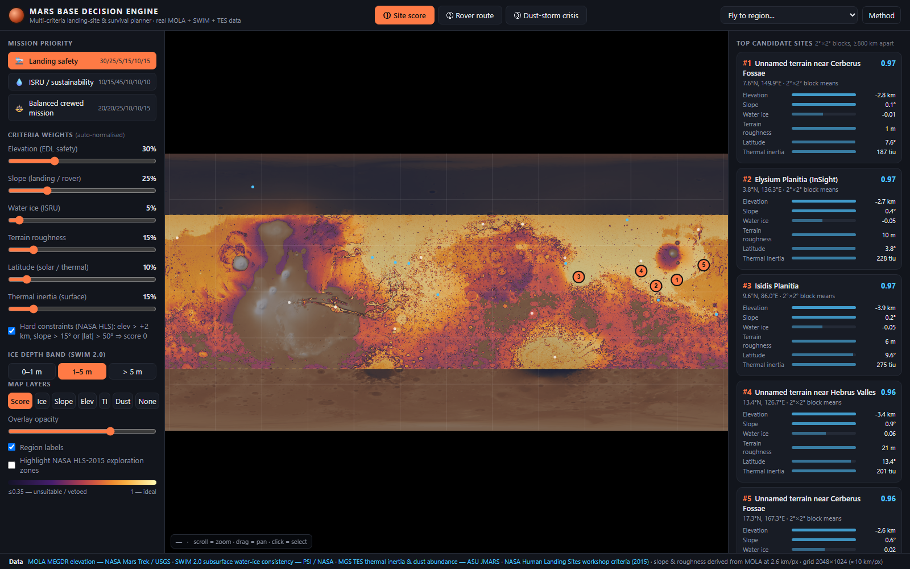

# Mars Base Decision Engine

**NASA Space Apps Challenge — "Interplanetary Survival Guide: Martian Map"**

A client-side planetary GIS and mission decision-support engine that fuses real NASA, USGS, PSI, and ASU orbital datasets into an actionable engineering planner answering *"Where should humans land and build a base on Mars, how do they traverse the surface safely, and how do they survive a global dust storm?"* — in both **2D Equirectangular** and **3D Interactive WebGL MOLA Topographic Globe** views.



## Core Modules & Capabilities

| Module | Engineering Question Answered | Orbital Datasets & Physical Models |
|---|---|---|
| **1. Site Selection** | Where is the optimal compromise between *safe EDL / landing* (low elevation, low slope, low roughness, moderate thermal inertia, equatorial insolation) and *sustainable ISRU* (shallow water ice)? Includes 3 mission presets, normalized sliders, NASA HLS-2015 vetoes, Top-5 candidate extraction, **ice-access classes** (SWIM agreement, no invented yield), share of ≤ 5° landing cells per candidate, optional no-compensation scoring (geometric mean), and **MSL-RAD GCR radiation shielding**. | MGS MOLA DEM, MOLA 90th-pct slope & roughness, PSI SWIM 2.0 ice (3 depth bands), MGS TES thermal inertia & dust abundance, Viking MDIM 2.1 optical mosaic |
| **2. Rover Traverse A\*** | Which corridor between surface coordinates avoids rover tip-over, rough terrain and Spirit-like soft-sand traps (low thermal inertia)? Runs an 8-connected, spherical multi-hazard A* pathfinder on MOLA slope, roughness, and TES dust grids; marks **candidate rest stops** (flat, smooth, firm cells at ≥ 200 km spacing) and compares distance, peak/mean slope, dust traps, and elevation profile against direct path. | MGS MOLA 90th-percentile slope, elevation & sub-cell roughness rasters, MGS TES thermal inertia |
| **3. Dust-Storm & Thermal Power** | If a 2018-class global storm ($\tau \approx 8\text{–}11$) strikes at an **Areocentric Season ($L_s \in [0^\circ, 360^\circ]$)**, how many sols does the habitat keep power and heat? Heating is charged to the energy budget beyond the waste heat of the electrical load; panel dust accumulates; fission units use the 10 kWe Kilopower design target. | Site latitude, Mars obliquity & eccentricity ($L_s$), Opportunity 2018 empirical $\tau$-attenuation, approximate surface-temperature model, Kilopower 10 kWe design target (KRUSTY 2018 demonstrated ~1 kWe) |
| **4. Habitability & Biosphere APIs** | What are the current space weather hazards, frozen InSight surface telemetry archive, and Earth vs. Mars biosphere habitability metrics? Queries same-origin proxy (`/api/*`) or NASA Open APIs (`api.nasa.gov`): the DONKI CME catalogue (live) and the InSight weather feed (frozen since sol 681 / 2020-10-26 archive). Every value is labelled LIVE / ARCHIVE / REFERENCE / OFFLINE; a failed request shows nothing rather than placeholder telemetry. Compares 6 Earth biosphere markers against Martian ECLSS countermeasures. | NASA DONKI CME API (live), NASA InSight Mars Weather API (archive), InSight climatology (Banfield et al. 2020) |
| **2D Map & 3D WebGL Globe** | Seamless switching between 2D Equirectangular map and hardware-accelerated **3D WebGL MOLA Displaced Globe** with 4K NASA Viking Orbiter MDIM 2.1 imagery, vertical relief exaggeration (`1×–15×`), directional solar hillshading, Rayleigh/dust limb scattering, and 3D raycast picking. | 4K NASA Viking MDIM 2.1 mosaic (`viking_4k.jpg`), 2048×1024 MOLA DEM vertex displacement & normal perturbation |
| **Mission Brief Export** | One-click **Export Brief** generates a structured **NASA-STD Mission Reconnaissance Dossier** with downloadable `.json` telemetry and a print/PDF-formatted engineering report. | Full synthesis of active weights, Top-5 candidates, A* traverse, candidate rest stops, and storm/thermal simulation |

Everything runs 100% client-side with zero external runtime libraries, no server, and no API keys (works offline by opening `web/index.html` directly). Supports both desktop mouse/keyboard and mobile/tablet touch gestures (pinch-to-zoom, 1-finger pan/orbit, tap designation).

## Run Locally

```
web/index.html          # open directly in any modern browser (Chrome / Edge / Firefox / Safari)
```

Deep links for interactive demos:

```
index.html?preset=isru
index.html?view=3d
index.html?demo=route&from=Jezero&to=Nili
index.html?demo=crisis&site=Arcadia&tau=9&kp=1
```

## Rebuild the Data Layers (Optional, ~5 min)

```powershell
cd data_pipeline
powershell -ExecutionPolicy Bypass -File download.ps1    # 512 MOLA tiles + 3 SWIM GeoTIFFs + 2 TES VICAR rasters + Viking MDIM 2.1 mosaic
pip install numpy pillow tifffile imagecodecs
python preprocess.py                                      # -> web/layers_data.js + web/layers/*.png + meta.json
python download_mola16.py                                 # 16-bit MOLA, every 5th row via HTTP range (~425 MB of 2.1 GB)
python mola16.py                                          # rebuild elev / slope / rough from 16-bit data
python build_5km.py                                       # shipped build: full 4096x2048 layer set (16-bit MOLA, SWIM, TES, caves)
```

## Automated Tests, E2E & Production Build

```bash
node tests/scoring.test.js     # core scoring / A* / storm / radiation / ice-access / heating / SPE / live-API tests
node tests/ui.test.js          # UI modules, SVG legends, Web Worker RPC, bilinear terrain, A* global wrap & rest stops
node tests/integrity.test.js   # DOM ID sync, metadata sync, strict zero-inline CSP, accessibility & asset hygiene
python tests/test_pipeline.py  # data pipeline unit checks
node tests/e2e.test.js         # headless Chromium E2E (HTTP + Web Worker + SwiftShader WebGL + strict CSP + file://)
node tools/build.js            # builds dist/ (34 files, 22.86 MB) excluding 25.63 MB file://-only layers_data.js
node tools/validate.js         # validation against real landers + HLS-2015 zones -> docs/validation.md
```

**Validation result:** the nine successful Mars landers rank in the **90th percentile** of their own latitude band under Landing safety (random: 50th, p < 0.005; partly circular, see notes), and all 39 NASA HLS-2015 candidate sites rank in the **71st percentile** under the Balanced preset (random: 49th, p < 0.005). Both hold under geometric-mean scoring. See [`docs/validation.md`](docs/validation.md).

Verifies suitability transfer functions, preset & geometric-mean aggregation behaviour, NASA HLS-2015 hard constraint vetoes, >= 75%-valid candidate extraction, Monte Carlo weight sensitivity, adaptive-window multi-hazard A* obstacle & dust-trap avoidance, flat/firm stop candidates, Opportunity-calibrated dust-storm attenuation, waste-heat/deficit thermal balance, MSL-RAD GCR & unified design-basis SPE shielding, seasonal $L_s$ insolation, SWIM ice-access classification, regional terrain class, XSS-escaped Mission Brief & Live API rendering, strict inline-free CSP, headless Chromium WebGL, and Web Worker RPC.

## Repository Layout

```
.github/         workflows/test.yml                 CI test runner (Node 20 + Python 3.12 + Chromium E2E)
CONTRIBUTING.md  Architecture, dual delivery, testing & strict CSP guide
data_pipeline/   download.ps1, download_tes.py, download_viking.py, preprocess.py, download_mola16.py, mola16.py, caves.py, build_5km.py
web/             index.html, style.css, app.js, worker.js, globe3d.js, live_api.js, scoring.js, astar.js, storm.js, regions.js, caves.js, layers/meta.js, layers_data.js
web/ui/          layers.js, i18n.js, panels.js, map2d.js, format.js, charts.js, markers.js, overlays.js, habitability.js, brief.js
tools/           validate.js, build.js, hls2015_ez_sites.json   Validation report, HTTP dist/ builder, 39 HLS-2015 sites
tests/           scoring.test.js, ui.test.js, integrity.test.js, test_pipeline.py, e2e.test.js
docs/            methodology.md, validation.md, pitch.md, yarisma_raporu_tr.md, guide/   Mathematical spec, validation, citations, pitch & competition report
```

## Primary Data Sources & Citations

* **MGS MOLA Elevation** — 16-bit MOLA MEGDR mosaic (USGS Astrogeology `Mars_MGS_MOLA_DEM_mosaic_global_463m`, int16 metres), sampled to 9216×4608 (~2.3 km/px) with HTTP range requests, used for elevation, 90th-percentile slope and sub-cell roughness; delivered at 4096×2048 (~5.2 km/px). Matches published landing-site elevations within 10 m.
* **NASA Viking Orbiter MDIM 2.1 Optical Mosaic** — Global colorized optical mosaic (`Mars_Viking_MDIM21_ClrMosaic_global_232m`, NASA Mars Trek / USGS), 4096×2048 px.
* **SWIM 2.0 Subsurface Water Ice** — Subsurface Water Ice Mapping composite consistency maps at 0–1 m, 1–5 m, and >5 m depth (Planetary Science Institute / NASA, `swim.psi.edu`), 3 km/px, ±60° latitude.
* **MGS TES Thermal Inertia & Dust Abundance** — Mars Global Surveyor Thermal Emission Spectrometer (Christensen et al.; Bandfield 2002) via ASU JMARS WMS (`TES_Thermal_Inertia_numeric`, `TES_Dust_numeric`).
* **Mars Global Cave Candidate Catalog v1** — 1062 cave-entrance / skylight candidates (Cushing 2017, USGS Astrogeology / PDS), used as an optional shelter-access criterion (weight 0 by default).
* **NASA HLS-2015 candidate sites** — 39 CTX mosaics published by USGS Astrogeology, used for validation.
* **NASA HLS-2015 Constraints** — First Landing Site / Exploration Zone Workshop for Human Missions to Mars (2015): elevation ≤ +2 km, |latitude| ≤ 50°, landing/traverse slope limits ≤ 5° / ≤ 15°.
* **Surface GCR Radiation & Dust-Storm Calibration** — MSL Curiosity RAD surface dose measurements at Gale Crater (Hassler et al., *Science* 2014, ≈232 mSv/yr) and MER Opportunity June 2018 global storm telemetry ($\tau \approx 10.8$, ~97% solar array loss).
